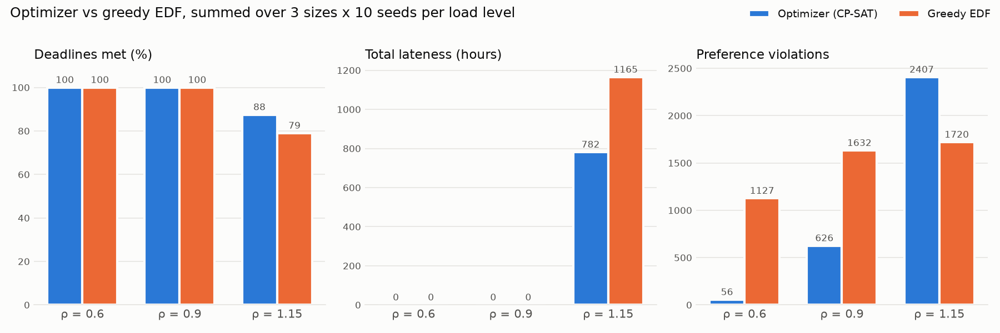

# AutoPlanner

A free web app that plans a student's week automatically. Add your classes, labs and
deadlines, and AutoPlanner places study blocks in 30-minute slots so that:

- every deadline is met (or, if that's impossible, you're told exactly why and how to fix it);
- demanding work lands in your focus hours;
- big tasks are split into chunks between your minimum and maximum block length;
- your day boundaries, blocked times and daily work limit are respected.

When a block doesn't happen, mark it **not done** and the rest of the week is replanned at once.
AutoPlanner learns how long you actually take for each kind of task and corrects new estimates.

**Live app:** [autoplanner.streamlit.app](https://autoplanner.streamlit.app). Create your own planner
with a private link.

**Quick look:** [autoplanner.streamlit.app/?demo=1](https://autoplanner.streamlit.app/?demo=1) opens a
realistic demo week with sample data, with no sign-up and nothing saved.

## Features

| | |
|---|---|
| Optimizer | Google OR-Tools CP-SAT over a 30-minute slot grid, up to 14 days ahead, in IST |
| Replanning | Done / not done per block; the plan is rebuilt from the current slot, keeping the past fixed |
| When it doesn't fit | The exact hours that can't fit, plus verified options: extend one deadline, or cut hours |
| Learning | A per-type correction factor from your confirmed actual time (e.g. "you take 1.3× on lab reports") |
| Import | Teams Assignments screenshots (Gemini, with Tesseract OCR as the fallback), pasted text, or manual entry; always reviewed in an editable table first |
| Export | An `.ics` file for Google Calendar |
| Privacy | No login: each planner has a private 256-bit link. Screenshots are never stored |

## Benchmark: optimizer vs greedy earliest-deadline-first

90 seeded workloads (10, 20 and 30 tasks; load ratio 0.6, 0.9 and 1.15; 10 seeds each), both
methods checked by the same independent validator:

| Totals over 90 workloads | Optimizer (CP-SAT) | Greedy EDF |
|---|---|---|
| Deadlines met | **1725** of 1800 | 1674 |
| Total lateness | **782 h** | 1165 h |
| Preference violations (demanding work outside focus hours + too-short blocks) | **3089** | 4479 |
| Solve time, 20 tasks / 7 days | median 1.5 s, p95 4.7 s | < 0.01 s |

When everything fits (load 0.6 and 0.9), both methods meet every deadline, and the optimizer has
62–95 % fewer preference violations. When overloaded (1.15), the optimizer meets more deadlines
and is a third less late; on the largest overloaded weeks it trades some focus-hour placement
for that.



Full tables, environment and solve-time statistics: [bench/results/REPORT.md](bench/results/REPORT.md).
Reproduce with `python -m bench.run_benchmark --seeds 10`.

## Screenshot import accuracy

- **Synthetic screenshots** (3 images, 15 assignments, fictional data): Gemini
  (`gemini-3.5-flash-lite`) read **15/15** rows correctly: the title and the deadline resolved from
  the due text. Tesseract's accuracy on the same images is checked in CI (target ≥ 80 %).
- **Real Teams screenshots**: measured locally only, with `python -m bench.eval_import` (targets:
  Gemini ≥ 90 %, Tesseract ≥ 60 %). Only aggregate numbers are published here.

## Run it locally

Requires Python 3.13.

```bash
python -m venv .venv
.venv/Scripts/activate            # Windows; on macOS/Linux: source .venv/bin/activate
pip install -r requirements-dev.txt
cp .streamlit/secrets.toml.example .streamlit/secrets.toml   # then fill in real values
streamlit run streamlit_app.py
```

The demo (`?demo=1`) works with no secrets at all. Planners need Supabase:

1. Create a free Supabase project and run [`db/schema.sql`](db/schema.sql) once in its SQL editor.
   Every table has row-level security on and no policies for the anon key.
2. Put the project URL and its **secret** key (`sb_secret_…`, never the publishable key) in
   `.streamlit/secrets.toml`, together with `GEMINI_API_KEY` and `GEMINI_MODEL`.

`.streamlit/secrets.toml` is git-ignored. Never commit it.

## Deploy on Streamlit Community Cloud

1. Push this repository to GitHub.
2. On share.streamlit.io, create an app from the repo: branch `main`, main file `streamlit_app.py`,
   and **Python 3.13** under Advanced settings (it can't be changed later without redeploying).
3. Paste the four secrets into the app's **Secrets** box, in the same TOML format as the local file.

`packages.txt` installs Tesseract on Cloud.

## Supabase keep-alive

Free Supabase projects pause after about a week without activity, which would break every planner
link. The [keep-alive workflow](.github/workflows/supabase-keepalive.yml) reads one row every third
day. It needs two repository secrets (Settings → Secrets and variables → Actions):
`SUPABASE_URL` and `SUPABASE_KEY`.

**GitHub disables scheduled workflows in public repositories after 60 days without repository
activity.** If that happens, open the **Actions** tab, select **Supabase keep-alive**, and click
**Enable workflow**, then **Run workflow** once to confirm it's green.

## Real Teams screenshots stay private

Real screenshots and their labels live only in `private/teams/`, which is git-ignored and never
committed. Tests and the demo use synthetic screenshots generated from fictional data
(`python tests/fixtures/make_synthetic_screenshots.py`); each carries a marker that a test checks.

To measure accuracy on your own screenshots locally:

1. Put the cropped screenshots (names removed) in `private/teams/`.
2. Write `private/teams/labels.json` in this format:

   ```json
   {"import_date": "2026-10-15",
    "images": [{"file": "1.png", "rows": [{"title": "Problem set 5", "deadline": "2026-10-16T17:00:00+05:30"}]}]}
   ```

3. Run `python -m bench.eval_import`. It prints aggregate numbers only; share those, never the
   titles or the images.

## Tests

```bash
pytest
```

The suite needs no network and no secrets: Gemini is mocked, and storage uses an in-memory
repository with the same contract as Supabase. Tesseract tests are skipped when the binary is
missing; CI installs it ([ci.yml](.github/workflows/ci.yml)).

## Project layout

| Path | What it holds |
|---|---|
| `streamlit_app.py` | Entry point and routing (`?demo=1`, `?p=<planner id>`) |
| `autoplanner/` | Slot grid, CP-SAT solver, greedy baseline, validator, diagnosis, learning, storage, export |
| `autoplanner/importers/` | Due-date resolver, paste/OCR parser, Gemini and Tesseract readers, review pipeline |
| `autoplanner/ui/` | Streamlit views: calendar, tasks and events, import, settings |
| `bench/` | Workload generator, benchmark runner and report, import accuracy evaluation |
| `db/schema.sql` | Supabase schema |
| `SPEC.md`, `PLAN.md` | Specification (requirements and acceptance criteria) and the build plan |
